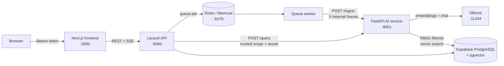

# Multi-Tenant Enterprise Knowledge & Compliance Assistant

An internal document Q&A platform. Organizations upload SOPs, policies and manuals (PDF/DOCX) tagged with a **department** and a **security clearance level**; employees ask questions in a streaming chat and get answers that cite the document and page they came from.

Access control is enforced **inside the vector search query**, so a user can never retrieve, or infer the existence of, a document outside their organization, department or clearance.

Runs natively on Windows: no Docker, no WSL.

## Architecture



| Service | Stack | Port | Responsibility |
|---|---|---|---|
| `backend/` | Laravel 13, Sanctum, Predis, Pest | 8000 | Auth, RBAC, uploads, queue, chat proxy, audit logs |
| `ai-service/` | FastAPI, pypdf, python-docx, pgvector, Ollama | 8001 | Chunking, embeddings, RBAC-filtered retrieval, streamed answers |
| `frontend/` | Next.js 16 (App Router), TypeScript, Tailwind 4, Playwright | 3000 | Login, documents dashboard, chat, audit log viewer |

The browser only ever talks to Laravel. The AI service listens on `127.0.0.1` and rejects any request without the shared secret.

## Security model

| Rule | Where it is enforced |
|---|---|
| Users only see their own organization | `Document::scopeVisibleTo()` and the `WHERE organization_id = %s` clause in `ai-service/rag.py` |
| Non-admins only see their own department | Same two places; admins drop the department filter but stay inside their organization |
| Clearance: a user at level N sees levels 1 to N | `clearance_level <= %s` in both places (1 Public, 2 Internal, 3 Confidential, 4 Restricted) |
| Scope is never taken from the client | `ChatController` builds it from the authenticated user via `User::retrievalScope()`; `ChatRequest` validates only `prompt` |
| Out-of-scope documents return 404, not 403 | `DocumentController::download()` |
| AI service is internal | `X-Internal-Secret` header checked with a constant-time compare |
| Audit log is append-only | Eloquent model guards plus database triggers on `audit_logs` (PostgreSQL and SQLite) |
| No answer without evidence | Retrieval below the similarity threshold returns a fixed refusal without calling the model |
| Admins manage only their own organization | `UserPolicy` and `SaveDepartmentRequest`; another organization's user or department returns 404 |
| Users are deactivated, never deleted | `users.deactivated_at`; deactivation revokes tokens, login refuses, and the `active` middleware rejects any remaining token |
| An organization always keeps an admin | Admins cannot change their own role or deactivate themselves |
| Admin changes are audited | Every user and department change writes an `audit_logs` row (`user.*`, `department.*`) |

Roles: **admin** (all departments in their organization, uploads, user and department management, audit logs), **manager** (own department, uploads up to their clearance), **staff** (own department, read and chat only).

## Prerequisites

| Tool | Notes |
|---|---|
| Laragon (PHP 8.3) | Enable `pdo_pgsql`, `pgsql`, `pdo_sqlite`, `sqlite3`, `zip`, `sodium` in `php.ini` |
| Composer 2.8+ | `composer self-update` |
| Python 3.12 | 3.11 also works |
| Node.js 20+ | |
| Ollama | `ollama pull nomic-embed-text` and `ollama pull llama3.2` |
| Redis on `127.0.0.1:6379` | Memurai Developer, or Laragon's bundled Redis |
| Supabase project | Free tier; pgvector is enabled by the migrations |

## Setup

```powershell
# 1. Backend
cd backend
composer install
copy .env.example .env
php artisan key:generate
# Edit .env: set DB_URL (Supabase session pooler URI) and INTERNAL_API_SECRET
php artisan migrate --seed

# 2. AI service
cd ..\ai-service
py -3.12 -m venv venv
.\venv\Scripts\python.exe -m pip install -r requirements-dev.txt
copy .env.example .env
# Edit .env: set DATABASE_URL (same URI) and the same INTERNAL_API_SECRET

# 3. Frontend
cd ..\frontend
npm install
copy .env.example .env.local
```

Use the **Session pooler** connection string from Supabase (port 5432). The transaction pooler (port 6543) does not support the prepared statements Laravel uses.

## Running (four terminals)

```powershell
# Terminal 1 - backend/
php artisan serve --port=8000

# Terminal 2 - backend/
php artisan queue:work redis

# Terminal 3 - ai-service/
.\venv\Scripts\activate
uvicorn main:app --reload --port 8001

# Terminal 4 - frontend/
npm run dev
```

Open http://localhost:3000.

### Demo accounts

Created by `php artisan db:seed`. Every password is `password`. Local development only.

| Email | Organization | Department | Role | Clearance |
|---|---|---|---|---|
| `admin@acme.test` | Acme Manufacturing | Compliance | admin | 4 Restricted |
| `manager@acme.test` | Acme Manufacturing | Procurement | manager | 3 Confidential |
| `hr@acme.test` | Acme Manufacturing | Human Resources | manager | 3 Confidential |
| `staff@acme.test` | Acme Manufacturing | Procurement | staff | 1 Public |
| `admin@globex.test` | Globex Logistics | Operations | admin | 4 Restricted |
| `manager@globex.test` | Globex Logistics | Operations | manager | 3 Confidential |
| `staff@globex.test` | Globex Logistics | Finance | staff | 2 Internal |

To see the isolation working: upload a Confidential document as `manager@acme.test`, then ask about it as `staff@acme.test` (refused), `hr@acme.test` (refused, different department) and `admin@globex.test` (refused, different organization).

## Tests

```powershell
# Backend: 59 Pest tests, in-memory SQLite, no external services needed
cd backend
php vendor\bin\pest
php vendor\bin\pest --filter="chat scope"          # a single group

# AI service: 17 pytest tests, no database or Ollama needed
cd ..\ai-service
.\venv\Scripts\python.exe -m pytest
.\venv\Scripts\python.exe -m pytest -k "admin"     # a single test

# Frontend: Playwright, Laravel API stubbed in the browser
cd ..\frontend
npx playwright install chromium                     # first time only
npx playwright test

# Same Playwright flow against the real running stack (all four terminals up, seeded)
$env:E2E_LIVE = "1"; npx playwright test
```

GitHub Actions (`.github/workflows/ci.yml`) runs all three suites on every push and pull request to `main`.

## API

| Method | Path | Access | Purpose |
|---|---|---|---|
| POST | `/api/login` | public | Returns a Sanctum token and the user profile |
| POST | `/api/logout` | signed in | Revokes the current token |
| GET | `/api/me` | signed in | Current profile |
| GET | `/api/departments` | signed in | Departments the user may upload to (admins also get user and document counts) |
| POST | `/api/departments` | admin | Create a department in the admin's organization |
| PUT | `/api/departments/{id}` | admin | Rename a department |
| GET | `/api/users` | admin | Paginated, searchable users of the organization (`?q=`) |
| POST | `/api/users` | admin | Create a user (clearance up to the admin's own) |
| PUT | `/api/users/{id}` | admin | Edit name, email, role, department, clearance, or reset the password |
| PUT | `/api/users/{id}/deactivate` | admin | Block sign-in and revoke tokens (not self) |
| PUT | `/api/users/{id}/reactivate` | admin | Restore access |
| GET | `/api/documents` | signed in | Documents within the user's scope |
| POST | `/api/documents` | admin, manager | Upload a PDF/DOCX (20 MB max); queues ingestion |
| GET | `/api/documents/{id}/download` | signed in | Download, re-checking scope |
| POST | `/api/chat` | signed in, 20/min | Streams the answer as Server-Sent Events |
| GET | `/api/audit-logs` | admin | Paginated, searchable log for the organization |

Chat stream events: `token` (`{"text"}`), `sources` (`{"sources":[{document_id, document_title, page_number}]}`), `done`, and `error` (`{"message"}`).

## Known limits

- DOCX files have no fixed pages, so their citations always read "Page 1".
- Scanned PDFs without a text layer cannot be indexed (no OCR); they are marked failed with an explanation.
- `php artisan serve` handles one request at a time on Windows, so other requests wait while an answer is streaming. Use a real web server for more than one concurrent user.
- The AI service reads uploads from the local disk. Moving to `FILESYSTEM_DISK=s3` works for Laravel as-is, but the AI service would then need to fetch the file from S3.
