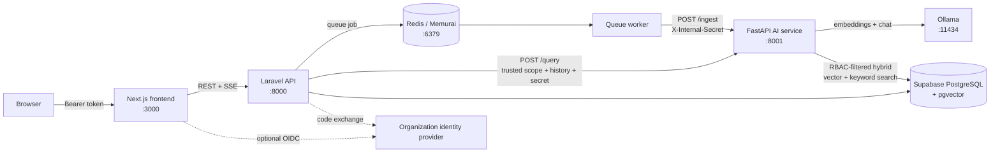

# Multi-Tenant Enterprise Knowledge & Compliance Assistant

An internal document Q&A platform. Organizations upload SOPs, policies and manuals (PDF, Word, Excel, PowerPoint, text) tagged with a **department** and a **security clearance level**; employees ask questions in a streaming chat and get answers that cite the document and page they came from.

Access control is enforced **inside the search query**, so a user can never retrieve, or infer the existence of, a document outside their organization, department or clearance. A golden evaluation set proves it on every CI run.

Runs natively on Windows: no Docker, no WSL.

## Architecture



| Service | Stack | Port | Responsibility |
|---|---|---|---|
| `backend/` | Laravel 13, Sanctum, Predis, Pest | 8000 | Auth and SSO, RBAC, user management, uploads and versions, queue, chat proxy and history, audit logs, analytics |
| `ai-service/` | FastAPI, pypdf, python-docx, pgvector, Ollama | 8001 | Extraction, injection screening, PII redaction, chunking, embeddings, hybrid retrieval, streamed answers, evaluation |
| `frontend/` | Next.js 16 (App Router), TypeScript, Tailwind 4, Playwright | 3000 | Login, chat with history, documents, users, analytics, processing, audit log |

The browser only ever talks to Laravel. The AI service listens on `127.0.0.1` and rejects any request without the shared secret.

## Features

| Area | What it does |
|---|---|
| Chat | Streaming answers with `[Title, Page N]` citations; only the documents the answer actually cites are listed as sources. Follow-up questions keep the conversation's context. |
| Conversation history | Every turn is saved for the user who asked it. Answers that cited a document the user can no longer access (lowered clearance, department move) are withheld, on screen and in follow-up context. |
| Document viewer | Any document opens in a side panel without downloading it: from the Documents page (**View**, or click the title), from a chat citation, or from a calendar event. PDFs show in the browser's viewer at the cited page; Word, Excel, PowerPoint, text and Markdown show as readable text, page by page (slides, sheets), scrolled to the cited one. Access is re-checked on every open. |
| Answer feedback | Thumbs up/down with an optional comment; thumbs-down answers surface on the analytics page as evaluation candidates. |
| Documents | PDF, DOCX, XLSX (a page per sheet), PPTX (a page per slide), TXT, MD. Re-uploading the same title in the same department creates a new version; the old one keeps answering until the new one is indexed. Reindex on demand. |
| Hybrid search | Codes, numbers and acronyms in the question (`PO-2024-11`, `10,000`, `KYC`) also run a scoped full-text search, fused with the vector search by reciprocal-rank fusion. |
| Document-trust defenses | Text that tries to steer the model ("ignore previous instructions") is held for admin approval and not indexed; emails, phone numbers, NRIC and card numbers are masked before embedding; excerpts reach the model wrapped as data. |
| OCR | Scanned PDF pages are OCR'd when Tesseract is installed (optional). |
| Users and departments | Admins create, edit, deactivate and reactivate users and manage departments in their own organization. |
| Single sign-on | Per-organization OpenID Connect (authorization code + PKCE). First-time users are created at the configured department, role and clearance (Internal at most). Password sign-in stays as break-glass. |
| Analytics | Questions per day, people asking, no-answer rate, helpful rate, most-cited documents, documents by clearance. |
| Processing | Failed documents, documents stuck waiting for a worker, and failed queue jobs (organization-scoped), with retry. |
| Audit log | Every prompt and every admin change, append-only, searchable, exportable as CSV. |
| Evaluation | A golden question set scored for answers, citations, refusals and RBAC safety, in CI and against the live stack. |
| Event calendar | Meetings, deadlines and trainings with a date are found in uploaded documents (English or Malay, in sentences or in schedule tables such as duty rosters, which give one event per row plus one for the whole period). Upcoming ones are confirmed or rejected by an admin or the department's manager; past ones from this year are added as history. Chips are green for past, red for today and yellow for upcoming. Events are shown on a month calendar to exactly the people who can see the source document. Upcoming events appear as a dismissable reminder banner; admins set how many days ahead it looks. Review decisions survive re-indexing and new versions. |

## Security model

| Rule | Where it is enforced |
|---|---|
| Users only see their own organization | `Document::scopeVisibleTo()` and `scope_filter()` in `ai-service/rag.py`, applied to every branch of the hybrid query |
| Non-admins only see their own department | Same places; admins drop the department filter but stay inside their organization |
| Clearance: a user at level N sees levels 1 to N | `clearance_level <= %s` in both places (1 Public, 2 Internal, 3 Confidential, 4 Restricted) |
| Scope is never taken from the client | `ChatController` builds it from the authenticated user via `User::retrievalScope()`; `ChatRequest` validates only `prompt` and the user's own `conversation_id` |
| Out-of-scope documents return 404, not 403 | `DocumentController`, `ConversationController`, `UserPolicy` |
| Saved history obeys today's access | `Conversation::messagesVisibleTo()` re-checks cited documents on every read and before sending history to the model |
| AI service is internal | `X-Internal-Secret` header checked with a constant-time compare |
| Audit log is append-only | Eloquent model guards plus database triggers on `audit_logs` (PostgreSQL and SQLite) |
| No answer without evidence | Retrieval below the similarity threshold (and without an exact-term match) returns a fixed refusal without calling the model |
| Uploaded text is untrusted | Injection screening holds suspicious documents (`flagged`) until an admin approves, audited; PII is masked in the index; excerpts are wrapped in `<document>` tags the text cannot close |
| Admins manage only their own organization | `UserPolicy`, `SaveDepartmentRequest`, org filters on processing, metrics, export and SSO settings |
| Users are deactivated, never deleted | `users.deactivated_at`; deactivation revokes tokens, login and SSO refuse, and the `active` middleware rejects any remaining token |
| An organization always keeps an admin | Admins cannot change their own role or deactivate themselves |
| SSO cannot take over accounts | The email must be verified and in the connection's domain; an existing account in another organization, or linked to another identity, is refused; state is single-use |
| CSV export cannot carry formulas | Cells starting with `= + - @` are prefixed with `'` |

Roles: **admin** (all departments in their organization, uploads, approvals, user and SSO management, analytics, processing, audit logs), **manager** (own department, uploads and reindex up to their clearance), **staff** (own department, read and chat only).

## Prerequisites

| Tool | Notes |
|---|---|
| Laragon (PHP 8.3) | Enable `pdo_pgsql`, `pgsql`, `pdo_sqlite`, `sqlite3`, `zip`, `sodium` in `php.ini` |
| Composer 2.8+ | `composer self-update` |
| Python 3.12 | 3.11 also works |
| Node.js 20+ | |
| Ollama | `ollama pull nomic-embed-text` and `ollama pull llama3.2` |
| Redis on `127.0.0.1:6379` | Memurai Developer, or Laragon's bundled Redis |
| Supabase project | Free tier; pgvector is enabled by the migrations |
| Tesseract (optional) | Only for OCR of scanned PDFs, see below |

## Setup

```powershell
# 1. Backend
cd backend
composer install
copy .env.example .env
php artisan key:generate
# Edit .env: set DB_URL (Supabase session pooler URI) and INTERNAL_API_SECRET
php artisan migrate --seed

# 2. AI service
cd ..\ai-service
py -3.12 -m venv venv
.\venv\Scripts\python.exe -m pip install -r requirements-dev.txt
copy .env.example .env
# Edit .env: set DATABASE_URL (same URI) and the same INTERNAL_API_SECRET

# 3. Frontend
cd ..\frontend
npm install
copy .env.example .env.local
```

Use the **Session pooler** connection string from Supabase (port 5432) with `?sslmode=require`. The transaction pooler (port 6543) does not support the prepared statements Laravel uses.

### Optional: OCR for scanned PDFs

```powershell
winget install UB-Mannheim.TesseractOCR
cd ai-service
.\venv\Scripts\python.exe -m pip install -r requirements-ocr.txt
```

Restart the AI service, then use **Reindex** on any document that failed with "No extractable text". Set `TESSERACT_CMD` in `ai-service/.env` if Tesseract is not in `C:\Program Files\Tesseract-OCR`.

### Optional: single sign-on

Sign in as an admin, open **Users → Single sign-on**, enter the provider's issuer URL, client ID and secret, the email domain, and the defaults for new accounts. Register the redirect URI shown there (`SSO_REDIRECT_URI`, by default `http://localhost:3000/sso/callback`) with the provider.

## Running (four terminals)

```powershell
# Terminal 1 - backend/
php artisan serve --port=8000

# Terminal 2 - backend/
php artisan queue:work redis

# Terminal 3 - ai-service/
.\venv\Scripts\activate
uvicorn main:app --reload --port 8001

# Terminal 4 - frontend/
npm run dev
```

Open http://localhost:3000. The queue worker keeps code in memory: restart it after changing backend job code.

### Demo accounts

Created by `php artisan db:seed`. Every password is `password`. Local development only.

| Email | Organization | Department | Role | Clearance |
|---|---|---|---|---|
| `admin@acme.test` | Acme Manufacturing | Compliance | admin | 4 Restricted |
| `manager@acme.test` | Acme Manufacturing | Procurement | manager | 3 Confidential |
| `hr@acme.test` | Acme Manufacturing | Human Resources | manager | 3 Confidential |
| `staff@acme.test` | Acme Manufacturing | Procurement | staff | 1 Public |
| `admin@globex.test` | Globex Logistics | Operations | admin | 4 Restricted |
| `manager@globex.test` | Globex Logistics | Operations | manager | 3 Confidential |
| `staff@globex.test` | Globex Logistics | Finance | staff | 2 Internal |

To see the isolation working: upload a Confidential document as `manager@acme.test`, then ask about it as `staff@acme.test` (refused), `hr@acme.test` (refused, different department) and `admin@globex.test` (refused, different organization).

## Tests

```powershell
# Backend: 131 Pest tests, in-memory SQLite, no external services needed
cd backend
php vendor\bin\pest
php vendor\bin\pest --filter="chat scope"          # a single group

# AI service: 114 pytest tests, no database or Ollama needed (the real-OCR test runs only where Tesseract is installed)
cd ..\ai-service
.\venv\Scripts\python.exe -m pytest
.\venv\Scripts\python.exe -m pytest -k "admin"     # a single test

# RAG evaluation (golden set in ai-service/eval/golden.jsonl)
.\venv\Scripts\python.exe -m eval.run_eval --structural   # in-process, as CI runs it
.\venv\Scripts\python.exe -m eval.run_eval --live         # against the running AI service + Supabase + Ollama
# Reports: ai-service/eval/reports/<mode>-latest.md and .json; exit code 1 on any RBAC violation

# Frontend: Playwright, Laravel API stubbed in the browser
cd ..\frontend
npx playwright install chromium                     # first time only
npx playwright test

# The sign-in/upload/chat flow against the real running stack (all four terminals up, seeded)
$env:E2E_LIVE = "1"; npx playwright test
```

GitHub Actions (`.github/workflows/ci.yml`) runs all three suites and the structural evaluation on every push and pull request to `main`.

## API

| Method | Path | Access | Purpose |
|---|---|---|---|
| POST | `/api/login` | public | Returns a Sanctum token and the user profile |
| POST | `/api/sso/start` | public | Authorization URL for the email domain's identity provider |
| POST | `/api/sso/callback` | public | Exchange the provider's code; signs in (and provisions) the user |
| POST | `/api/logout` | signed in | Revokes the current token |
| GET | `/api/me` | signed in | Current profile |
| GET | `/api/departments` | signed in | Departments the user may upload to (admins also get user and document counts) |
| POST | `/api/departments` | admin | Create a department in the admin's organization |
| PUT | `/api/departments/{id}` | admin | Rename a department |
| GET | `/api/users` | admin | Paginated, searchable users of the organization (`?q=`) |
| POST | `/api/users` | admin | Create a user (clearance up to the admin's own) |
| PUT | `/api/users/{id}` | admin | Edit name, email, role, department, clearance, or reset the password |
| PUT | `/api/users/{id}/deactivate` | admin | Block sign-in and revoke tokens (not self) |
| PUT | `/api/users/{id}/reactivate` | admin | Restore access |
| GET | `/api/documents` | signed in | Current versions within the user's scope (`?include_superseded=1` for older ones) |
| POST | `/api/documents` | admin, manager | Upload PDF/DOCX/XLSX/PPTX/TXT/MD (20 MB max); same title = new version; queues ingestion |
| GET | `/api/documents/{id}/download` | signed in | Download, re-checking scope |
| GET | `/api/documents/{id}/preview` | signed in | Text of a non-PDF document, page by page, for the in-app viewer; `format: pdf` for PDFs; re-checks scope |
| POST | `/api/documents/{id}/reindex` | admin, manager in scope | Queue the document again |
| POST | `/api/documents/{id}/approve` | admin | Release a document held for review (audited) |
| POST | `/api/chat` | signed in, 20/min | Streams the answer as Server-Sent Events; `conversation_id` for a follow-up |
| GET | `/api/events?from=&to=` | signed in | Confirmed events in the window (default: this month), scoped like documents |
| GET | `/api/events/upcoming` | signed in | Reminders: confirmed events within the organization's window, minus dismissed; review count for reviewers |
| POST | `/api/events/{id}/dismiss` | signed in, in scope | Silence one reminder (the event stays on the calendar) |
| GET | `/api/events/pending` | admin, manager | Events waiting for review in the reviewer's scope |
| POST | `/api/events/{id}/confirm` | admin, manager in scope | Confirm, optionally correcting title and dates (audited) |
| POST | `/api/events/{id}/reject` | admin, manager in scope | Reject an extraction (audited) |
| GET, PUT | `/api/admin/settings` | admin | Organization settings: `event_reminder_days` (1 to 60) |
| GET | `/api/conversations` | signed in | The user's own conversations |
| GET | `/api/conversations/{id}` | owner | Messages, with withheld answers masked |
| DELETE | `/api/conversations/{id}` | owner | Delete a conversation (the audit log keeps the prompts) |
| POST | `/api/messages/{id}/feedback` | owner | Rate an answer `{helpful, comment?}`; re-rating replaces |
| GET | `/api/audit-logs` | admin | Paginated, searchable log for the organization |
| GET | `/api/audit-logs/export` | admin | The same filtered log as CSV |
| GET | `/api/admin/metrics` | admin | Analytics for `?days=` (1 to 365) |
| GET | `/api/admin/processing` | admin | Failed and stuck documents, failed queue jobs |
| POST | `/api/admin/failed-jobs/{id}/retry` | admin | Queue a failed job's document again |
| DELETE | `/api/admin/failed-jobs/{id}` | admin | Remove a failure record |
| GET, PUT | `/api/admin/sso` | admin | The organization's single sign-on settings (secret is write-only) |

Chat stream events: `token` (`{"text"}`), `sources` (`{"sources":[{document_id, document_title, page_number}]}`), `done`, and `error` (`{"message"}`), relayed unchanged from the AI service; then Laravel adds `saved` (`{"conversation_id", "title", "message_id"}`).

## Known limits

- DOCX, TXT and MD files have no fixed pages, so their citations read "Page 1"; slides and sheets are cited by number.
- Non-PDF documents open in the viewer as text only: formatting, tables' layout and images are not shown (Download gives the original). Very long documents are cut after about 300,000 characters in the viewer.
- OCR needs Tesseract plus `requirements-ocr.txt`; without them, scanned PDFs fail with an explanation and can be reindexed later.
- Injection screening is heuristic: it catches common phrasings, not every attack. The prompt-level data wrapping is the second line of defense.
- PII masking applies to the search index and answers, not the stored file, which authorized users can still download.
- SSO reads the identity from the provider's userinfo endpoint after a server-side code exchange; it does not validate the ID token signature, so the provider must be reached over HTTPS (enforced).
- `php artisan serve` handles one request at a time on Windows, so other requests wait while an answer is streaming. Use a real web server for more than one concurrent user.
- The AI service reads uploads from the local disk. Moving to `FILESYSTEM_DISK=s3` works for Laravel as-is, but the AI service would then need to fetch the file from S3.

## Project documents

| Document | Contents |
|---|---|
| [docs/roadmap.md](docs/roadmap.md) | Phase 1: the 15 modules built, and open items |
| [docs/roadmap-phase-2.md](docs/roadmap-phase-2.md) | Phase 2: proposed modules 16 to 29, with a build order |
| [docs/module-29-event-calendar.md](docs/module-29-event-calendar.md) | Full design of module 29, the event calendar |
| [knowledge/introduction.md](knowledge/introduction.md) | The original specification |
| [knowledge/blueprint.md](knowledge/blueprint.md) | Windows installation guide and daily runbook |
| [CLAUDE.md](CLAUDE.md) | Working rules for Claude Code in this repository |
